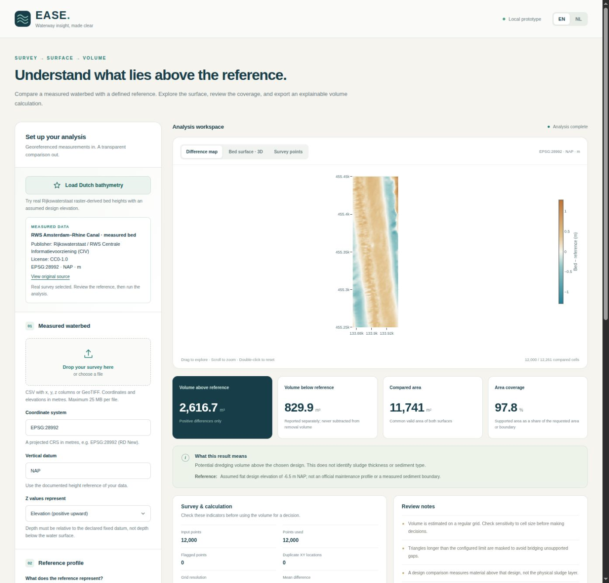
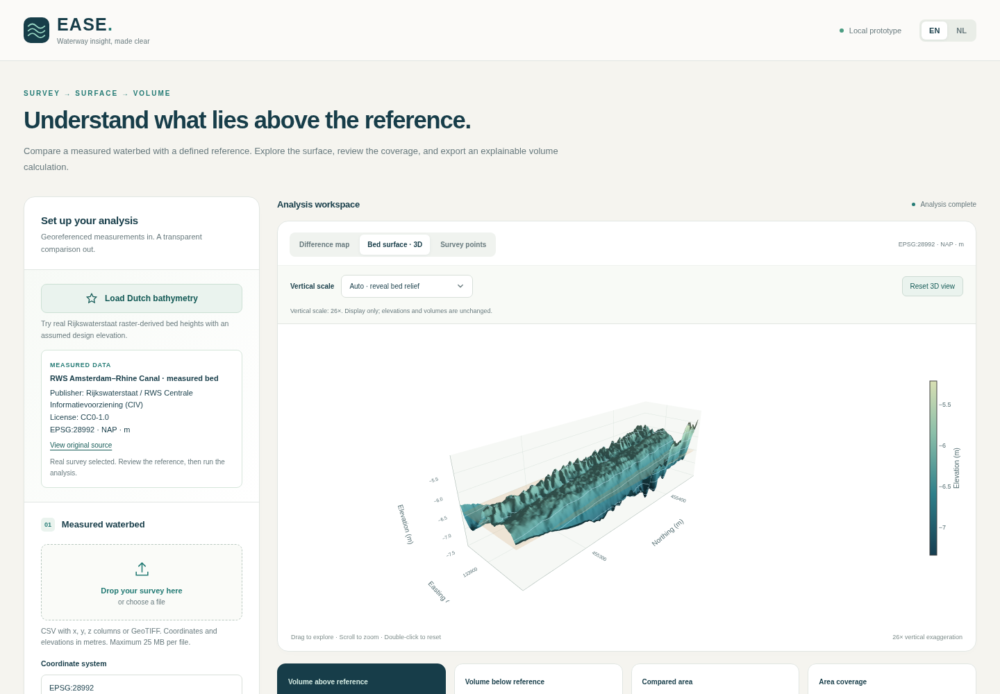
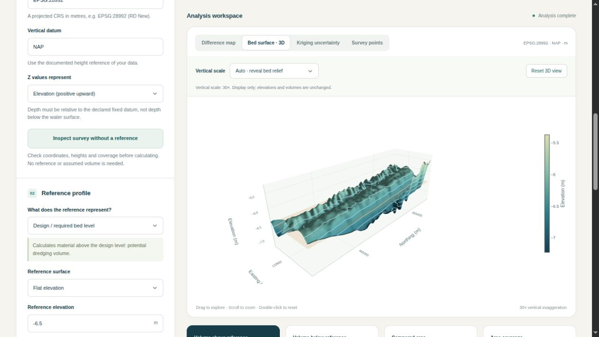
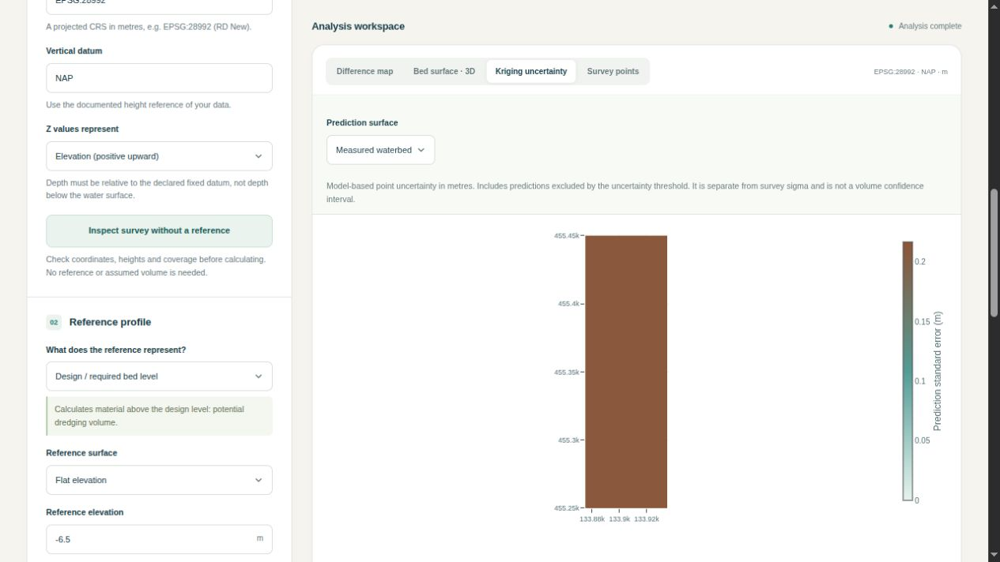

# EASE · Sediment volume explorer

[](https://github.com/Manouselis/ease-sediment-volume-explorer/actions/workflows/pages.yml)

A working local English/Dutch prototype for comparing a measured waterbed with a declared reference. It accepts corrected XYZ, single-band GeoTIFF or a zipped 3D point shapefile, flags potential outliers, offers bounded linear TIN or experimental Ordinary Kriging surfaces, calculates separate volumes above/below the reference, and exports the calculation. Survey inspection also works without a reference or a volume calculation.

**A design comparison is potential dredging volume. It does not identify sludge, its composition, or its actual underside.** The Sonoptix ECHO raw-to-bathymetry interface remains unverified.

Explore the [public Rijkswaterstaat demo](https://manouselis.github.io/ease-sediment-volume-explorer/). See the [deployment guide](docs/DEPLOYMENT.md) for the protected analysis API, Pages builds and releases.

## Start locally

For a fresh installation, use Python 3.10 or 3.11, Git, and an internet connection. The tested environment is Linux with Python 3.10.12:

```sh
git clone --recurse-submodules https://github.com/Manouselis/ease-sediment-volume-explorer.git
cd ease-sediment-volume-explorer
./setup.sh
./run.sh
```

Open **http://127.0.0.1:8765**. Stop with Ctrl+C. After installation, restart with `./run.sh` from the repository root. A different port can be selected with `EASE_PORT=8766 ./run.sh`.

If you already cloned without submodules:

```sh
git submodule update --init --recursive
./setup.sh
```

`setup.sh` initializes the GeoUtils submodule, uses `uv` if available (otherwise Python's `venv` and pip), installs the pinned dependencies from `requirements.txt`, and generates the local Plotly browser bundle. A system Python installation must provide `venv`; geospatial dependencies normally install from wheels. Other platforms/Python versions have not been verified. GeoUtils is pinned to commit `fda51a598f81f8cdd5f96855ae59edb23738ac45`.

The browser assets, including Plotly, are local after setup. The app and included demo then work without an internet connection. The server binds to localhost. Uploaded inputs and results stay in `runs/` until you delete them; the localhost server has no accounts or automatic retention policy. Generated assets, environments, uploads and results are excluded from Git.



## First calculation

1. Click **Load Dutch bathymetry**. This loads 12,000 genuine Rijkswaterstaat multibeam-derived bathymetry cells near Utrecht, in metres RD New/NAP.
2. Review the reference: a **hypothetical** flat design at −6.5 m NAP, not an official canal profile.
3. Click **Run Analysis**. View the difference map, 3D bed and measured-bed map.
4. Review coverage and warnings, then download the ZIP, cell CSV, point CSV, GeoTIFF or JSON summary.
5. Switch **EN / NL** at the top; the results remain loaded.

The **Bed surface · 3D** view uses perspective, lighting and elevation contours.
Its **Vertical scale** defaults to Auto so shallow canal relief remains visible.
The displayed factor is explicit; choose **1×** for true metre proportions or
another factor to inspect the shape. Drag to rotate, scroll to zoom, and use
**Reset 3D view** to restore the initial camera. These display settings leave
the measured elevations, calculated volumes and exports unchanged.



With the supplied defaults the result is **2,616.673785 m³ above** and **829.907363 m³ below** the reference, over **11,741 m²** (97.841667% of the supplied 12,000 m² boundary). The TIN covers the hull of pixel centres, so the half-pixel border of the source raster is excluded. Source cell spacing is not a measurement-accuracy claim.

## Surface-generation choice

**Linear TIN** remains the default. Choose **Ordinary Kriging (experimental)**
under Processing settings to predict directly at calculation sample locations.
The choice applies to the bed and any uploaded reference. Both methods retain
bounded observed coverage and the shared volume calculation.

Kriging offers automatic/manual spherical, exponential and Gaussian variograms,
manual nugget/partial sill/range, local neighbour and search-distance settings,
and an optional maximum prediction standard error. Resolved parameters appear
in the results and exports. The uncertainty map and bundled variance/standard
error TIFFs describe model-based point uncertainty, not volume confidence.

See [KRIGING.md](docs/KRIGING.md) for parameter units, noise assumptions, exclusion
rules, limits and the reproducible public-data comparison. Kriging has a limit of
20,000 supported predictions per surface. Missing predictions remain unknown.
There is no automatic fallback to TIN. Existing TIN demo totals below remain its
regression baseline, not Kriging results.





## Your own data

**Processed shapefile ZIP:** upload one PointZ shapefile together with its matching `.shx`, `.dbf` and `.prj` files in a ZIP. The importer reads X, Y and Z from the point geometry, checks the embedded horizontal CRS and retains the supplied heights. It does not guess elevations from colours, contour lines or DBF fields. A horizontal `.prj` does not prove a vertical datum such as NAP. See [SHAPEFILE_INPUTS.md](docs/SHAPEFILE_INPUTS.md).

Click **Inspect survey without a reference** to review the recorded points and their elevation range in 3D. For a long waterway, switch to **Plan view**, zoom into a short reach and click **Use visible map area**, or enter bounds manually. The selected box crops both surfaces' points before triangulation and limits the integration grid. It appears in the exported configuration. Clearing or changing the area invalidates old results. Excluded points are counted separately. The plots use a documented display sample, while inspection statistics and calculations use all eligible input points.

Inspection does not require a design level, previous survey or sediment underside. Volume calculation still requires an explicitly described reference. Do not raise the triangle edge limit merely to fill an unsurveyed canal width. Sparse tracks can have very little supported area even when their along-track point spacing is small.

**XYZ CSV/TXT/XYZ:** UTF-8 text with a header and numeric `x,y,z` columns. Comma, semicolon, tab or whitespace delimiters are accepted; use a decimal point. `easting,northing,elevation` and documented header aliases are accepted. Extra columns are ignored. Headerless XYZ needs an `x y z` header added first.

```csv
x,y,z
133875.864804,455449.789551,-5.92
133876.864804,455449.789551,-6.04
133875.864804,455448.789551,-5.98
```

Declare the actual projected metric CRS and vertical datum. The example uses `EPSG:28992` and `NAP` (`EPSG:5709` is accepted as an alias). Z normally means elevation, positive upward. The optional positive-down convention means depth relative to that **fixed datum**, converted as elevation = −depth. Raw depth below a changing water surface is not accepted as corrected bathymetry merely by choosing that option.

**GeoTIFF:** one elevation/depth band, projected metric CRS, with valid NoData. Its embedded CRS must match the declaration. `vertical_datum`, `units` and `z_convention` tags, when present, must agree. With no vertical tags the datum/sign are explicitly user-declared, not independently verified. GeoTIFF pixels are converted to centre XYZ and reconstructed through the selected surface-generation route with the same coverage mask; original raster edges are therefore conservatively reduced to supported centre geometry.

**Reference:** choose a constant design elevation, or upload a CSV/GeoTIFF/PointZ ZIP surface. An earlier survey or observed sediment underside requires a file with provenance. File comparisons require the same CRS and vertical datum. The app rejects mismatches; it performs no survey reprojection or vertical datum transformation. A sparse reference may require a larger maximum TIN edge, applied to both surfaces.

For a straight canal reach, choose **Standard design profile** in the web
app and enter the code, signed design water level and alignment. View
a 3D and along-reach comparison for a single track, or calculate volume
over supported overlap with a survey across the canal. EASE evaluates
the design directly and exports its RD New/NAP XYZ. The standalone
command is also available. [Design profile guide](docs/DESIGN_PROFILES.md)

**Boundary (optional):** GeoJSON Polygon/MultiPolygon, including holes. Standard GeoJSON coordinates are WGS84 longitude/latitude. Legacy projected GeoJSON is accepted only with an explicit top-level `crs` (the included demo uses RD New). Boundary coordinates are transformed horizontally to the survey CRS. Without a boundary, coverage is relative to the measured TIN's rectangular bounding box.

Limits: 100 MiB per survey file, 25 MiB per reference, boundary or SND file, 100,000 points per surface, and 500,000 input raster/output grid cells. Use a representative canal subsection for this MVP. Format validation cannot establish that a CSV's declared units or datum are truthful.

In **Measured waterbed**, use **Preprocess survey with Hydromagic SND** to pair an original survey export with its matching sounding file. Inspection and analysis exclude points whose height correction is missing. Confirm the retained NAP elevations before estimating volume. [Hydromagic export review](docs/HYDROMAGIC_REVIEW.md)

## Calculation and exports

See [ALGORITHMS.md](docs/ALGORITHMS.md) for the exact processing, equation, filtering and numerical limitations.

- `summary.json`: totals, warnings, input hashes, configuration, dataset metadata and upstream commit.
- `cells.csv`: regular cell centre, actual integration sample, bed/reference elevations, signed difference, **supported area**, validity. Use this area for volume reproduction.
- `points.csv`: exact-XY median observations, potential-outlier flags and whether used. Flag mode preserves them; exclusion is an explicit choice. Original uploads remain alongside outputs.
- `bed.tif`, `reference.tif`, `difference.tif`: georeferenced masked grids with CRS/datum/sign tags. **Partial-cell areas are in the cell CSV**; multiplying every GeoTIFF pixel by a full cell area will overcount clipped borders.
- `bundle.zip`: all surface result files, plus Kriging uncertainty products when selected. Browser plots may be decimated for display; calculations and exports are full resolution.

The grid is an approximation to the selected surface volume, particularly at sign changes and triangle boundaries. Check sensitivity to cell size and maximum edge. A finer grid does not create better measurements.

## Reproduce and test

From the repository root:

```sh
.venv/bin/python scripts/run_demo.py
.venv/bin/python scripts/verify_demo.py
PYTEST_DISABLE_PLUGIN_AUTOLOAD=1 .venv/bin/python -m pytest -q
```

The independent verifier reads original source XYZ and exported integration samples, computes barycentric interpolation separately, clips cell areas separately and checks the reported totals. It does not validate field accuracy. The test environment uses the environment variable to avoid unrelated system/ROS pytest plugins.

See [VALIDATION.md](docs/VALIDATION.md) for executed numerical results and [REAL_DATA.md](docs/REAL_DATA.md) for source, license, download and exact conversion. The raw downloaded source and official metadata are included. Regenerate the example offline with `scripts/download_demo.py --offline`; omit `--offline` for a fresh download.

The optional Playwright smoke test checks the running browser interface: `node scripts/ui_smoke.cjs` with Playwright installed, and `EASE_URL` if using a different address. It generates ignored browser QA screenshots in `qa/`.

## Open-source foundation and upstream workflow

[GeoUtils](https://github.com/GlacioHack/geoutils) is tracked as a pinned Git submodule in `vendor/geoutils/` and installed from that source. It supplies georeferenced masked raster construction, I/O, arithmetic and exports. SciPy supplies Delaunay triangulation, linear interpolation and neighbour searches. PyKrige supplies the bounded Ordinary Kriging solves. The application adds the input validation, bounded support, filtering, integration, API and bilingual interface. GeoUtils itself is not a raw-sonar processor. Its reference-alignment call checks an already shared grid, rather than resampling a native reference raster directly.

[OPEN_SOURCE_EVALUATION.md](docs/OPEN_SOURCE_EVALUATION.md) compares five credible candidates and explains the selection. [THIRD_PARTY.md](docs/THIRD_PARTY.md) records attribution, licenses and the exact upstream commit. New application code is Apache-2.0; upstream source retains its own notices.

The app replaces the **downstream surface comparison** part of an eligible Hydromagic/FME workflow. Hydromagic documents [XYZ/GeoTIFF matrix exports](https://www.eye4software.com/hydromagic/documentation/manual/post-processing/export-matrix/). Export corrected, reviewed elevations, preserve the CRS/datum record, add an XYZ header if needed, and upload here. FME can also deliver matching XYZ/GeoTIFF and a boundary. Neither application has been installed or tested in this environment, and native ECHO support is not established.

[Sonoptix ECHO](https://sonoptix.com/specifications) is forward-looking imaging sonar. Integration would first need documented frame decoding and calibrated bed detection/reconstruction, sufficient angular geometry, sound-speed handling, synchronized position/attitude, offsets and a traceable vertical reference. Validate the resulting XYZ against independent survey controls before using it for volume. This MVP implements none of those raw-sensor steps. It also does not classify sediment, measure density, fit CUBE, read CAD/canal sections, provide constrained breaklines, or calculate a defensible volume confidence interval.

This is a focused implementation for the 25-hour assignment scope. Remaining project effort should prioritize obtaining confirmed design elevations and alignment and one independently checked XYZ survey, then comparing outputs over identical coverage with the existing workflow.

## Repository workflow

GeoUtils is a submodule, so pull its recorded revision with the application:

```sh
git pull --recurse-submodules
git submodule update --init --recursive
```

Use conventional commit messages, for example `feat: add difference map`,
`fix: preserve clipped boundary cells`, or `docs: clarify reference profiles`.
Run the relevant checks before committing. Commit source, tests, documentation
and the public example data; leave environments, uploads, generated results and
browser captures ignored. Setup regenerates the Plotly JavaScript bundle.
