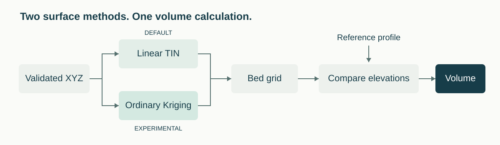

# Ordinary Kriging in EASE

Linear TIN remains the default. Ordinary Kriging is an experimental alternative
for predicting bed elevations from corrected XYZ. It is not a raw sonar decoder,
height correction or sludge classifier. Obtain corrected heights and a
site-specific reference before using predictions in a volume calculation.



The diagram shows the bed branch. An uploaded reference uses the same selected method.
Coverage restrictions and the declared reference determine what volume can be reported.

## Operator workflow

1. Load corrected XYZ, PointZ ZIP or elevation GeoTIFF. Declare the actual CRS,
   vertical datum and sign. Selecting NAP performs no height transformation.
2. Select a short reach and provide a documented reference.
3. Choose **Surface generation**: Linear TIN or Ordinary Kriging (experimental).
4. Select a variogram and automatic or manual parameters. Start with automatic
   fitting, then inspect the resolved values. Manual defaults are illustrations.
5. Review the difference map, 3D bed, uncertainty map, coverage and warnings.
6. Export the bundle. Compare against withheld observations and refine the grid
   before using a volume for a decision.

The chosen method and settings apply to both the bed and an uploaded reference.
Each has its own automatic fit. A constant reference has no fitted model or
Kriging uncertainty. Reference observations are not outlier-filtered. The summary
identifies the effective method and fitted parameters for each role.

## Parameters and defaults

| Control | Default | Meaning |
|---|---|---|
| Variogram | Spherical | Spherical, exponential or Gaussian spatial relationship |
| Fit | Automatic | Fit on at most 512 retained observations, fixed seed 42 |
| Nugget | 0.005 m² in manual mode | Unresolved variation just beyond zero distance |
| Partial sill | 0.2 m² in manual mode | Correlated variance, excluding the nugget |
| Range | 20 m in manual mode | Model correlation-distance parameter |
| Maximum neighbours | 16 | Nearest 3 to 64 observations in the same connected coverage |
| Maximum search distance | 20 m | Neighbours beyond this distance are unavailable |
| Maximum standard error | Blank | Optional cell-exclusion threshold in metres |
| Coverage triangle limit | Existing setting | Reject triangles spanning long observed gaps for either method |

Total sill = partial sill + nugget. The API uses `kriging_partial_sill`, never an
ambiguous `sill`. PyKrige uses the spherical range at the sill and practical-range
conventions for exponential/Gaussian models. The current model is isotropic.
Directional variation, trends and anisotropy require further evaluation.

The model uses **exact interpolation at retained observations**. The nugget is
unresolved process variation, not a calibrated sensor-noise filter. Measurements
are preserved. Gaussian models with small nugget and long range can be ill
conditioned. Numerical failure is reported, never replaced silently by TIN.

Automatic fitting is exploratory. It uses the measured elevation differences,
including any unresolved trend. A fixed seed makes the sample repeatable for the
same retained input order. Summary provenance records its size and hash, library
version and resolved parameters. Check the variogram and withheld predictions.
Constant or degenerate automatic fits fail with guidance to inspect the data or
choose justified manual parameters. No arbitrary fallback model is inserted.

## Calculation and support

The pipeline is corrected XYZ, coverage geometry, Kriging at integration sample
locations, reference comparison, then area-weighted volume summation.

Delaunay geometry through original retained measurements still defines coverage.
Rejected long triangles, raster NoData and boundary holes remain excluded.
Neighbours are restricted to the connected components of accepted triangles.
No predicted point is inserted into a TIN. Triangles supply no Kriging elevations.
A triangle mask is conservative but cannot detect every unsurveyed area or act as
a constrained bank/breakline model. An explicit boundary remains useful.

Both methods use the same grid and clipped plan areas. Partial cells use their
area centroid or the existing interior fallback. Kriging predicts at those actual
sample locations, not always at nominal cell centres. This is point quadrature,
not block Kriging or an exact integral of a curved surface. Refine spacing to
check numerical sensitivity. A finer grid adds no measured information.

For valid cells, positive volume is the sum of max(bed minus reference, 0) times
supported area. Negative volume is reported separately. Against a design this is
potential dredging material. Against a previous survey it is bed change. An actual
sludge layer requires independently identified material and a reliable underside.

## Uncertainty and exclusions

Kriging returns point prediction variance in m² and standard error in m. This is
conditional on the fitted model and exact-observation convention. It excludes
variogram parameter uncertainty, model misspecification, systematic datum error
and separately calibrated sonar/GNSS uncertainty. It is not a volume confidence
interval. Nearby prediction errors are correlated.

The existing optional survey/reference sigmas remain a separate user-assumed
change-detection scenario. They are not replaced by or added to Kriging variance.

The uncertainty map includes finite predictions excluded by the standard-error
threshold. With a constant reference only the bed uncertainty is available.
Regularly spaced measurements can give an almost uniform uncertainty map.
That reflects the model and sampling geometry, not verified survey accuracy.

A cell is excluded if either surface lacks three neighbours within its radius,
or either predicted standard error exceeds the optional threshold. When no cells
remain, the calculation returns an explicit error. There is no volume result.
Excluded area is unknown, not zero volume. Summary fields report geometric area,
prediction-excluded area and reasons. A threshold applies to each surface's point
standard error, not to a combined bed-minus-reference confidence interval.

## Exports and reproducibility

- `summary.json`: requested configuration and effective per-surface parameters.
- `cells.csv`: original columns plus bed/reference variance, standard error,
  exclusion reason and geometric area before prediction exclusions. Supported
  area is the final integration area and is zero for excluded cells.
- `bed_kriging_variance.tif` and `bed_kriging_standard_error.tif`.
- Matching reference uncertainty TIFFs when a reference file is interpolated.
- The result bundle contains these alongside the existing surface products.

Uncertainty TIFFs retain finite excluded predictions and label that fact in tags.
Use cell validity and supported area when reproducing volume. Partial-cell values
are stored at regular raster indices but evaluated at the CSV's actual sample XY.
TIN has no Kriging variance. Its CSV uncertainty fields are blank, not zero.

## Performance limits

PyKrige 1.7.3 is pinned and BSD-3-Clause licensed. Its constructor computes pairwise
distances and its execute path builds a system for all input points, even with a
moving prediction window. EASE never constructs it with an entire large survey.

Automatic fitting uses at most 512 points. Each prediction system uses at most
64 original neighbours. Equal neighbourhoods share a solve within a request.
The bounded pairwise arrays are therefore 512 by 512 for fitting and at most
64 by 64 for local systems. Spatial search and coverage still use all retained
points. Requests are limited to 20,000 geometrically supported prediction locations
per surface. Other input/grid limits remain. Use a shorter reach or coarser grid
when rejected. There is no global survey-sized dense covariance matrix.

The full 12,000-point public demo took about 7.08 seconds in one local run, with
11,741 m² retained coverage. Peak process RSS was about 709 MiB including Python,
GIS imports and the full analysis. This is not incremental Kriging memory, a memory
ceiling or a cross-platform benchmark. Runtime depends on neighbourhoods and data.

## Reproduce the comparison

```sh
PYTEST_DISABLE_PLUGIN_AUTOLOAD=1 .venv/bin/python -m pytest -q
.venv/bin/python scripts/compare_surfaces.py
```

The comparison writes ignored outputs under `qa/comparison/`. It uses 800
unmodified public RWS raster cell means, a common 1 m grid and 741 m² footprint,
with filtering off and a hypothetical -6.5 m NAP design.

| Quantity | TIN | Ordinary Kriging |
|---|---:|---:|
| Above assumed design | 5.1533 m³ | 5.1415 m³ |
| Below assumed design | 191.9469 m³ | 192.2447 m³ |
| Calculation time, one run | 0.10 s | 0.48 s |
| Held-out strip RMSE | 0.02054 m | 0.01558 m |
| Held-out strip bias | +0.01287 m | +0.00581 m |

The test withholds an entire two-metre X strip: 720 training and 80 test points.
All 80 receive common valid predictions. Kriging is fitted on training data only.
Its RMS predicted standard error is 0.06665 m. The test evaluates one spatial gap
in already processed cell means, not sonar accuracy or independent field truth.
The result does not establish general Kriging superiority or calibrated prediction
intervals. More spatial folds, alternative reaches, trend/anisotropy checks and
independent controls remain future work. Volume disagreement alone is not accuracy.

## Sources

- [PyKrige OrdinaryKriging API](https://geostat-framework.readthedocs.io/projects/pykrige/en/stable/generated/pykrige.ok.OrdinaryKriging.html)
- [PyKrige solver source](https://github.com/GeoStat-Framework/PyKrige/blob/v1.7.3/src/pykrige/ok.py)
- [PyKrige licence](https://github.com/GeoStat-Framework/PyKrige/blob/v1.7.3/LICENSE)
- [Kriging model assumptions](https://doc.esri.com/en/arcgis-pro/latest/help/analysis/geostatistical-analyst/kriging-in-geostatistical-analyst.html)
- [Validation and held-out observations](https://doc.esri.com/en/arcgis-pro/latest/help/analysis/geostatistical-analyst/performing-cross-validation-and-validation.html)
